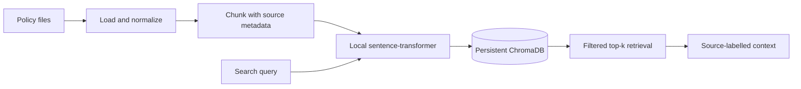

# Customer Support Resolution Agent

An agentic AI system that investigates customer support issues, retrieves relevant business policies, proposes resolutions, executes approved actions, and records verified outcomes.

## Project Status

🚧 In development

## Overview

This project simulates a customer support system for a fictional online electronics retailer.

The system will handle customer issues such as:

- Order status
- Refund requests
- Damaged items

The goal is to demonstrate how an AI agent can work with business data, policies, APIs, and human approval while keeping sensitive actions controlled and auditable.

## Tech Stack

- Python
- LangGraph
- FastAPI
- PostgreSQL
- pgvector
- Docker

## Architecture

The system will consist of:

- **FastAPI** — API layer and request handling
- **LangGraph** — Agent workflow orchestration
- **PostgreSQL** — Application data, workflow state, approvals, and audit records
- **RAG** — Retrieval of applicable support policies
- **Mock Services** — Simulated payment, shipping, and ticketing APIs

## Key Principles

The project separates AI reasoning from business-critical execution.

The AI can:

- Investigate customer issues
- Retrieve relevant information
- Retrieve applicable policies
- Propose resolutions

Application code is responsible for:

- Authentication and authorization
- Ownership checks
- Financial calculations
- Eligibility enforcement
- Approval validation
- External API execution
- Retry and idempotency controls
- State transitions

## Initial Scope

The first version will:

- Use synthetic customer and business data
- Support one store and one currency
- Require human approval for refunds
- Use mock payment and shipping services
- Support one customer issue per workflow
- Keep customer communication inside the demo application

Complex cases such as chargebacks, fraud adjudication, and partial returns are outside the initial scope.

## Project Goals

The project aims to demonstrate:

1. Agentic workflow design
2. API and system integration
3. Retrieval-augmented generation
4. Human-in-the-loop approval
5. Safe execution of financial actions
6. Idempotent and recoverable workflows
7. Auditable system behavior
8. Evaluation based on verified business outcomes

## Knowledge retrieval (RAG)

The knowledge service indexes Markdown, plain text, and text-based PDFs. It extracts and normalizes text, splits it into overlapping chunks, embeds chunks locally with `sentence-transformers/all-MiniLM-L6-v2`, and persists vectors plus source metadata in a ChromaDB collection. Query text uses the same model. Search results include similarity distance and source metadata; context assembly labels each excerpt with its document and category for later grounded agent answers.



### Add and index knowledge

Put `.md`, `.txt`, or text-based `.pdf` files under `knowledge_base/`. Use a category subdirectory such as `refunds/`, `shipping/`, or `faqs/`; the subdirectory name becomes the searchable category. The sample files are explicitly marked as synthetic demonstration policies. Scanned PDFs require OCR, which is not included.

Configure `KNOWLEDGE_BASE_DIR`, `CHROMA_PERSIST_DIR`, `CHROMA_COLLECTION_NAME`, `EMBEDDING_MODEL_NAME`, `EMBEDDING_DEVICE`, `KNOWLEDGE_CHUNK_SIZE`, `KNOWLEDGE_CHUNK_OVERLAP`, `KNOWLEDGE_TOP_K`, and `KNOWLEDGE_CONTEXT_MAX_CHARS` through the environment. Defaults use the repository's `knowledge_base/`, `.data/chroma/`, and the local MiniLM model. The first embedding run needs the model available in the local Hugging Face cache (otherwise the library downloads it).

Run ingestion as often as needed; unchanged content hashes are skipped and changed files replace their existing chunks:

```powershell
python -m pip install -e .
python scripts/ingest_knowledge_base.py
```

Example API calls (server: `uvicorn app.main:app --reload`):

```http
POST /api/v1/knowledge/ingest
Content-Type: application/json

{"filename": "refunds/refund-eligibility.md"}
```

Omit the body to ingest the configured directory. Other endpoints are `GET /api/v1/knowledge/documents`, `GET /api/v1/knowledge/documents/{document_id}`, `DELETE /api/v1/knowledge/documents/{document_id}`, and `POST /api/v1/knowledge/search` with `{"query":"When will an approved refund arrive?","top_k":5,"category":"refunds"}`. Search responses contain source-labelled context and chunk distances, never embedding vectors or absolute source paths.

Run the project test suite with `python -m pytest`. Unit tests use fake embedders/stores; the Chroma persistence integration test runs when ChromaDB is installed. A semantic end-to-end test can use a locally cached model when `RUN_REAL_EMBEDDING_TESTS=1`.

## Resolution recommendation workflow

`POST /api/v1/tickets/{ticket_id}/resolution-recommendation` invokes a LangGraph `StateGraph`. Its nodes load the ticket, gather customer/order/item/payment/refund/shipment context, classify the issue and note missing records, search the existing knowledge service, ask the configured LLM for a recommendation, and validate the structured response. A missing ticket ends at the conditional ticket-input branch and returns HTTP 404. Provider, retrieval, or workflow failures return HTTP 503.

The recommendation is advisory. The graph has no payment, refund, order, shipment, or ticket mutation calls. The model is instructed not to decide refund eligibility or authoritative amounts, and the workflow always sets `human_review_recommended` to true. Returned policy sources retain chunk IDs and available document metadata.

The LLM adapter uses an OpenAI-compatible Chat Completions endpoint. Configure `LLM_API_KEY`, `LLM_MODEL`, `LLM_BASE_URL`, and `LLM_TIMEOUT_SECONDS`; `LLM_BASE_URL` defaults to `https://api.openai.com/v1`, model defaults to `gpt-4o-mini`, and no key is required for the rest of the application. Copy `.env.example` to `.env` and supply a key locally. The API key is never returned to clients or included in application error messages.

Example:

```http
POST /api/v1/tickets/42/resolution-recommendation
```

The response includes `ticket_id`, `issue_category`, `issue_summary`, `customer_context_summary`, `retrieved_knowledge_sources`, `proposed_resolution`, `explanation`, `confidence_score`, `missing_information`, `human_review_recommended`, `action_required`, and `required_action`. Refund tickets set `action_required=true` and `required_action=refund_approval_review`; the recommendation graph pauses at this handoff and cannot execute the refund. Run the workflow tests with `python -m pytest tests/unit/test_agent_workflow.py`; these use an injected fake LLM and do not call a provider.

## Agent tools and refund approvals

Validated read-only support tools are in `app/tools/support.py`: customer/order lookup, payment and refund history, shipment tracking, deterministic refundable-balance checks, and order/shipping action preparation. Lookups verify the customer owns the order and associated ticket/payment/shipment. The order and shipping preparation tools only return proposals because no corresponding mutation services exist.

Refund approvals are persisted in `refund_approvals` and move through `pending -> approved -> executed` or `pending -> rejected`. A payment may have only one active (pending or approved) approval at a time. Create and review requests using the following operator endpoints:

| Method and path | Purpose |
| --- | --- |
| `POST /api/v1/refund-approvals/tickets/{ticket_id}` | Create a pending request with `order_id`, `payment_id`, `requested_amount`, `policy_basis`, and `reason` |
| `GET /api/v1/refund-approvals/pending` | List pending requests |
| `GET /api/v1/refund-approvals/{approval_id}` | View a request |
| `POST /api/v1/refund-approvals/{approval_id}/approve` | Approve with `{"confirm_policy_review": true}` |
| `POST /api/v1/refund-approvals/{approval_id}/reject` | Reject with `{"reason": "..."}` |
| `POST /api/v1/refund-approvals/{approval_id}/execute` | Resume the DB-backed workflow; runs only after approval |
| `GET /api/v1/refund-approvals/{approval_id}/execution` | View the resulting refund |

Request creation requires `X-Approval-Request-Token` matching `APPROVAL_REQUEST_API_KEY` and records `APPROVAL_REQUEST_ACTOR_ID`. Listing, viewing, approving, rejecting, executing, and reading results require `X-Approval-Token` matching `APPROVAL_API_KEY` and record `APPROVAL_ACTOR_ID`. Both distinct credentials must be configured with at least 32 characters, and the actor IDs must differ; the application disables these operations if role separation is misconfigured. The creator cannot approve their own request. All actor identities come from configuration rather than caller-supplied actor fields. Request amounts must come from trusted support/customer input, never LLM-generated amounts. Keep both credentials in a secret manager. This is a two-service shared-secret authorization model for the demo; replace it with per-user identity/role authorization before multi-operator production use.

The allowed `policy_basis` values are `unused_original_packaging`, `faulty_item`, `incorrect_item`, `partial_return`, `missing_item`, and `price_adjustment`. Approval creation, approval, and execution recheck ticket/order/payment ownership, successful payment status, and remaining captured balance in application code. For `unused_original_packaging`, the application enforces the 30-day delivery window; for `faulty_item` and `incorrect_item`, it enforces 90 days using the earliest recorded shipment delivery timestamp as a conservative order-level proxy. The schema does not link items to shipments or record return receipt/item condition, so the approving operator must explicitly confirm manual policy review. The approved request amount is checked against the current refundable balance again at execution. The execution transaction creates the refund and marks the approval executed together, uses an approval-scoped idempotency key, and leaves the approval approved if execution fails. The LLM cannot approve a refund or supply its authoritative amount. Refund recommendations use a fixed review handoff; a separate LangGraph resume graph re-reads persistent approval status and cannot resume from stale in-memory state.

Run approval/tool tests with `python -m pytest tests/unit/test_refund_approvals.py tests/unit/test_support_tools.py tests/api/test_refund_approvals_api.py`. Run the complete test suite with `python -m pytest`.
