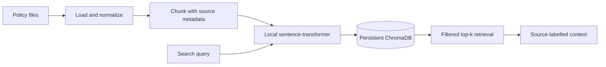

# Customer Support Resolution Agent

An agentic AI system that investigates customer support issues, retrieves relevant business policies, proposes resolutions, executes approved actions, and records verified outcomes.

## Project Status

🚧 In development

## Overview

This project simulates a customer support system for a fictional online electronics retailer.

The system will handle customer issues such as:

- Order status
- Refund requests
- Damaged items

The goal is to demonstrate how an AI agent can work with business data, policies, APIs, and human approval while keeping sensitive actions controlled and auditable.

## Tech Stack

- Python
- LangGraph
- FastAPI
- PostgreSQL
- pgvector
- Docker

## Architecture

The system will consist of:

- **FastAPI** — API layer and request handling
- **LangGraph** — Agent workflow orchestration
- **PostgreSQL** — Application data, workflow state, approvals, and audit records
- **RAG** — Retrieval of applicable support policies
- **Mock Services** — Simulated payment, shipping, and ticketing APIs

## Key Principles

The project separates AI reasoning from business-critical execution.

The AI can:

- Investigate customer issues
- Retrieve relevant information
- Retrieve applicable policies
- Propose resolutions

Application code is responsible for:

- Authentication and authorization
- Ownership checks
- Financial calculations
- Eligibility enforcement
- Approval validation
- External API execution
- Retry and idempotency controls
- State transitions

## Initial Scope

The first version will:

- Use synthetic customer and business data
- Support one store and one currency
- Require human approval for refunds
- Use mock payment and shipping services
- Support one customer issue per workflow
- Keep customer communication inside the demo application

Complex cases such as chargebacks, fraud adjudication, and partial returns are outside the initial scope.

## Project Goals

The project aims to demonstrate:

1. Agentic workflow design
2. API and system integration
3. Retrieval-augmented generation
4. Human-in-the-loop approval
5. Safe execution of financial actions
6. Idempotent and recoverable workflows
7. Auditable system behavior
8. Evaluation based on verified business outcomes

## Knowledge retrieval (RAG)

The knowledge service indexes Markdown, plain text, and text-based PDFs. It extracts and normalizes text, splits it into overlapping chunks, embeds chunks locally with `sentence-transformers/all-MiniLM-L6-v2`, and persists vectors plus source metadata in a ChromaDB collection. Query text uses the same model. Search results include similarity distance and source metadata; context assembly labels each excerpt with its document and category for later grounded agent answers.



### Add and index knowledge

Put `.md`, `.txt`, or text-based `.pdf` files under `knowledge_base/`. Use a category subdirectory such as `refunds/`, `shipping/`, or `faqs/`; the subdirectory name becomes the searchable category. The sample files are explicitly marked as synthetic demonstration policies. Scanned PDFs require OCR, which is not included.

Configure `KNOWLEDGE_BASE_DIR`, `CHROMA_PERSIST_DIR`, `CHROMA_COLLECTION_NAME`, `EMBEDDING_MODEL_NAME`, `EMBEDDING_DEVICE`, `KNOWLEDGE_CHUNK_SIZE`, `KNOWLEDGE_CHUNK_OVERLAP`, `KNOWLEDGE_TOP_K`, and `KNOWLEDGE_CONTEXT_MAX_CHARS` through the environment. Defaults use the repository's `knowledge_base/`, `.data/chroma/`, and the local MiniLM model. The first embedding run needs the model available in the local Hugging Face cache (otherwise the library downloads it).

Run ingestion as often as needed; unchanged content hashes are skipped and changed files replace their existing chunks:

```powershell
python -m pip install -e .
python scripts/ingest_knowledge_base.py
```

Example API calls (server: `uvicorn app.main:app --reload`):

```http
POST /api/v1/knowledge/ingest
Content-Type: application/json

{"filename": "refunds/refund-eligibility.md"}
```

Omit the body to ingest the configured directory. Other endpoints are `GET /api/v1/knowledge/documents`, `GET /api/v1/knowledge/documents/{document_id}`, `DELETE /api/v1/knowledge/documents/{document_id}`, and `POST /api/v1/knowledge/search` with `{"query":"When will an approved refund arrive?","top_k":5,"category":"refunds"}`. Search responses contain source-labelled context and chunk distances, never embedding vectors or absolute source paths.

Run the project test suite with `python -m pytest`. Unit tests use fake embedders/stores; the Chroma persistence integration test runs when ChromaDB is installed. A semantic end-to-end test can use a locally cached model when `RUN_REAL_EMBEDDING_TESTS=1`.
